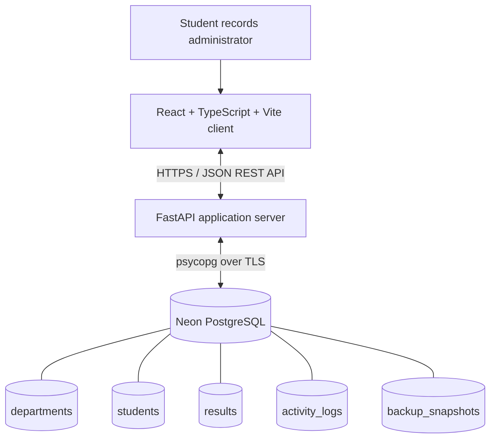
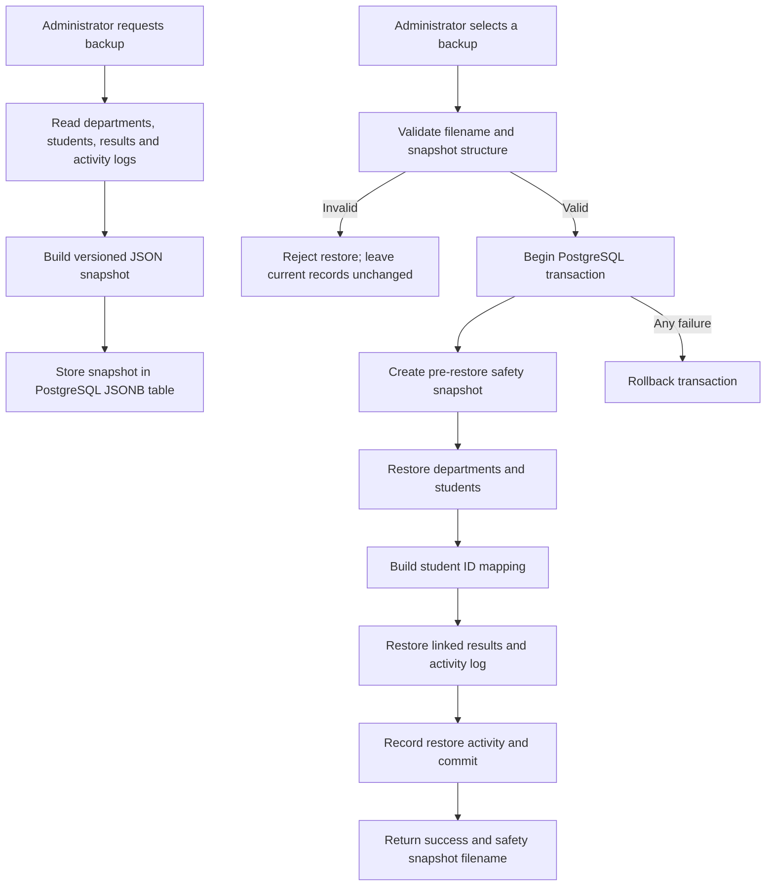

# CampusBook architecture

## System overview

CampusBook is a client/server student records application. The browser-based React client does not connect directly to PostgreSQL. It sends HTTPS requests containing JSON to the FastAPI application server. FastAPI validates requests, applies application rules, and accesses PostgreSQL through the `psycopg` driver.

## Deployment

- **Frontend:** React + TypeScript + Vite, deployed as a Render Static Site.
- **Application server:** Python FastAPI, deployed as a Render Web Service.
- **Database:** PostgreSQL 17 hosted by Neon.
- **Database access:** the backend connects with the restricted `campusbook_app` runtime role. The separate owner role is used for schema administration and migrations.
- **Configuration:** the API uses `DATABASE_URL` and `CAMPUSBOOK_CORS_ORIGINS`; the frontend build uses `VITE_API_URL`.

The frontend and API are separate services. The API is the only application component that accesses the database. The public README lists the live frontend, API health endpoint, and interactive API documentation.

## Main data entities

- **Department:** unique department name and code.
- **Student:** unique matriculation number, first name, last name, email, department label, level, status, and creation timestamp.
- **Result:** student foreign key, course code/title, score from 0 to 100, and semester. Deleting a student cascades to that student's results.
- **Activity log:** action, details, and UTC timestamp.
- **Backup snapshot:** unique filename, JSONB snapshot payload, and creation timestamp.

## Request flow

1. The React client sends a request to the FastAPI REST endpoint over HTTPS.
2. FastAPI validates input using Pydantic models and performs application-level checks.
3. The API opens a PostgreSQL connection using `psycopg`.
4. PostgreSQL executes the query and enforces constraints such as unique matriculation numbers, score range, and result-to-student foreign keys.
5. FastAPI returns JSON and an appropriate HTTP status code to the client.

## REST endpoint summary

| Method | Endpoint | Purpose |
| --- | --- | --- |
| GET | `/api/health` | Check API and database connectivity |
| GET | `/api/dashboard` | Dashboard counts and summaries |
| GET / POST | `/api/students` | List/search and create students |
| PUT / DELETE | `/api/students/{id}` | Update and delete a student |
| GET / POST | `/api/departments` | List and create departments |
| GET / POST | `/api/results` | List and record course results |
| DELETE | `/api/results/{id}` | Delete a course result |
| GET / POST | `/api/backups` | List and create snapshots |
| POST | `/api/backups/{filename}/restore` | Validate and restore a snapshot |
| GET | `/api/activity` | Read recent activity records |

## Backup and recovery design

CampusBook implements an application-level logical backup. When a backup is requested, the API reads the `departments`, `students`, `results`, and `activity_logs` tables and stores their data in a versioned JSONB snapshot in the `backup_snapshots` table.

During recovery:

1. The API validates the backup filename and checks the snapshot format version and required table fields.
2. It captures the current database state as a pre-restore safety snapshot.
3. Within the same PostgreSQL transaction, it removes the current application records and restores departments.
4. It restores students and builds an old-to-new student ID map.
5. It restores results using that ID map so foreign-key relationships remain valid.
6. It restores the activity log and records the restore event.
7. If an operation fails, the transaction rolls back rather than leaving a partially restored set of records.

### Backup limitation

The JSONB snapshots are stored in the same Neon database as the application records. They demonstrate logical backup and application-level recovery, but they are not independent disaster-recovery copies. Loss or deletion of the entire database/project could also remove these snapshots. For real institutional data, an independent export or managed backup/PITR strategy and tested retention policy would be needed.

## Security and scope

- The database runtime role is restricted; schema ownership is kept separate.
- Database credentials are configured as deployment environment variables and are not committed to the public repository.
- CORS is configured through an explicit environment variable.
- The project is a public academic demonstration. Use fictional records only.
- The supplied assignment brief does not state a requirement for authentication or multiple user roles. The current implementation should not be represented as having those features.

## Availability notes

The frontend is a static site. The free Render API service may spin down after 15 minutes without inbound traffic and can take time to wake on the next request. Neon compute may also suspend while idle and resume when queried. These free-tier services are appropriate for a demonstration, but they do not provide an always-on uptime guarantee.

## Technology summary

| Layer | Technology |
| --- | --- |
| Client | React, TypeScript, Vite |
| Application server | Python, FastAPI, Pydantic |
| API style | REST over HTTPS with JSON |
| Database | PostgreSQL 17 on Neon |
| Database driver | psycopg |
| Hosting | Render Static Site + Render Web Service |
| Backup format | Versioned JSON snapshot stored as PostgreSQL JSONB |
