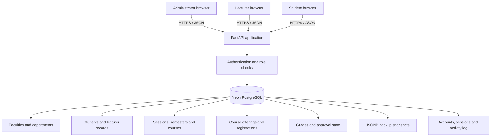

# CampusBook architecture

## System architecture

CampusBook is a three-tier client/server application:

1. **Client:** React, TypeScript and Vite provide the administrator, lecturer and student interfaces.
2. **Application server:** FastAPI validates requests, authenticates users, enforces role permissions and implements academic workflows.
3. **Database:** PostgreSQL stores institutional, student, course, registration, grade, account and audit records.

The browser never connects directly to PostgreSQL. It sends HTTPS/JSON requests to FastAPI. The application server uses parameterised SQL through psycopg.



## Roles and permissions

- **Administrator / Registrar:** manages student records, departments, courses, sessions, semesters, lecturer records and accounts; opens course offerings; reviews grade submissions; approves/publishes results; manages backups and activity logs.
- **Lecturer:** accesses only assigned course offerings, views the enrolled roster, enters/imports marks, saves drafts and submits completed rosters for approval.
- **Student:** accesses only their own academic records, browses offerings eligible for their department and level, registers/drops courses during the registration window and views published results.

Public account registration is disabled. Administrators provision student and lecturer accounts. The first administrator is created through a one-time, environment-secret-protected bootstrap operation.

Passwords are hashed with Argon2id. Authenticated sessions are stored server-side as token digests and expire after 12 hours. Role checks are enforced by FastAPI, not only by frontend navigation.

## Academic information architecture

```text
University
└── Faculty
    └── Department
        ├── Students
        └── Course catalogue
            └── Course offering (session + semester + section)
                ├── Assigned lecturer
                ├── Student registrations (class roster)
                └── Grades for each registration
```

A student belongs to a department, and each department belongs to a faculty. A course is defined once in the catalogue. Each delivery of that course in an academic session and semester is a separate offering. A lecturer is assigned to an offering, not permanently to a course.

The grade belongs to the student's registration for a particular course offering. The database enforces one registration per student per offering and one grade per registration.

## Student course registration workflow

1. An administrator creates an academic session and semester and defines the registration window.
2. An administrator creates a course offering, assigns a lecturer and opens it for registration.
3. An authenticated student sees offerings matching their department and level.
4. The student registers or drops a course while the registration window permits it.
5. The API rejects duplicate, closed, full or ineligible registrations.

The current V1 eligibility rule is department and level matching. Prerequisites, maximum credit-unit rules and programme-specific elective groups are outside this academic demonstration's scope.

## Lecturer grade workflow

1. A lecturer signs in and sees only assigned offerings.
2. The lecturer opens an offering and receives the registered class roster.
3. Marks are entered in the roster grid or imported from a CSV with `matric_number,score` columns.
4. The lecturer reviews the values, saves draft grades and submits the completed roster.
5. The API checks that every registered student has a valid score from 0 to 100.
6. An administrator reviews and publishes the submitted roster.
7. Published grades are read-only through the lecturer workflow.

V1 stores a total score from 0 to 100. It does not invent a CA/exam weighting or institutional letter-grade scale.

## Main database entities

| Entity | Purpose |
|---|---|
| `faculties` | Faculty directory |
| `departments` | Department and faculty relationship |
| `students` | Student identity, matriculation number, department, level and status |
| `lecturers` | Lecturer identity and department |
| `academic_sessions` / `semesters` | Academic calendar and registration windows |
| `courses` | Department-owned course catalogue |
| `course_offerings` | A course delivered in a session/semester/section and assigned to a lecturer |
| `course_registrations` | Student enrolment in an offering |
| `course_grades` | Score and submission/approval state for a registration |
| `user_accounts` / `user_sessions` | Login identity, role, password hash and session state |
| `results` | Legacy demonstration results retained for migration compatibility |
| `activity_logs` | Important system actions |
| `backup_snapshots` | Versioned logical JSONB snapshots |

Student email is not collected in V1 and is excluded from student API responses. The legacy database column is retained only for compatibility and contains non-routable dummy values.

## REST API overview

| Method | Endpoint | Purpose |
|---|---|---|
| POST | `/api/auth/bootstrap` | One-time first-administrator creation; requires bootstrap secret |
| POST | `/api/auth/login` / `logout` | Create/revoke a session |
| GET | `/api/auth/me` | Current authenticated account |
| GET | `/api/dashboard` | Administrator dashboard |
| GET / POST | `/api/students` | Search/list and create student records |
| PUT / DELETE | `/api/students/{id}` | Update/delete student records |
| GET / POST | `/api/departments` | List/create departments |
| GET | `/api/faculties` | Faculty directory |
| GET / POST | `/api/admin/courses` | Manage course catalogue |
| GET / POST | `/api/admin/lecturers` | Manage lecturer records |
| GET / POST | `/api/admin/academic-sessions` | Manage academic sessions |
| GET / POST | `/api/admin/semesters` | Manage semesters and registration windows |
| POST | `/api/admin/course-offerings` | Open a course offering and assign lecturer |
| POST / DELETE | `/api/student/course-offerings/{id}/register` | Student course registration/drop |
| GET | `/api/student/registrations` | Student's own registrations |
| GET | `/api/lecturer/offerings/{id}/roster` | Assigned lecturer's class roster |
| PUT / POST | `/api/lecturer/offerings/{id}/grades`, `submit` | Save and submit grade roster |
| POST | `/api/admin/offerings/{id}/approve` | Approve/publish submitted grades |
| GET / POST | `/api/backups` | List/create logical snapshots |
| POST | `/api/backups/{filename}/restore` | Validate and restore a snapshot |
| GET | `/api/activity` | Administrator activity log |

Protected endpoints require an authenticated session and the correct server-enforced role. The health endpoint remains public and reports service/database readiness.

## Backup and recovery

CampusBook creates versioned logical JSONB snapshots in PostgreSQL. V2 snapshots include the academic structure, students, lecturers, sessions, semesters, courses, offerings, registrations, grades, accounts, legacy results and activity log. Active sessions are revoked during restore; session tokens are not restored.

Before restoring, the API creates a safety snapshot, validates the selected backup, restores the related records in dependency order and resets identity sequences. V1 legacy snapshots are rejected once V1 academic records/accounts exist because they do not contain the complete academic structure.

**Important limitation:** snapshots are stored in the same Neon project/database. They demonstrate application-level backup and recovery but are not independent disaster-recovery copies. A separate export or managed backup is required for protection against loss of the whole database project.

## Matriculation number

New student records must follow `DE/YYYY/NNNN`, for example `DE/2023/0001`. Existing legacy records are not silently rewritten by the API; synthetic demo records were migrated to the new pattern.

## Deployment

The existing live deployment remains on Render with Neon PostgreSQL. Render Free web services spin down after 15 minutes without inbound traffic. A Vercel FastAPI preview project and isolated Neon preview branch are being used to validate the serverless deployment path. The production frontend is not switched until the preview, authentication, CORS/session flow and full integration tests pass.

The database remains in the Frankfurt region. The Vercel API preview is configured for the Frankfurt function region to keep application/database traffic close.

The application uses UTC for stored timestamps; the browser formats them in the viewer's local timezone.
