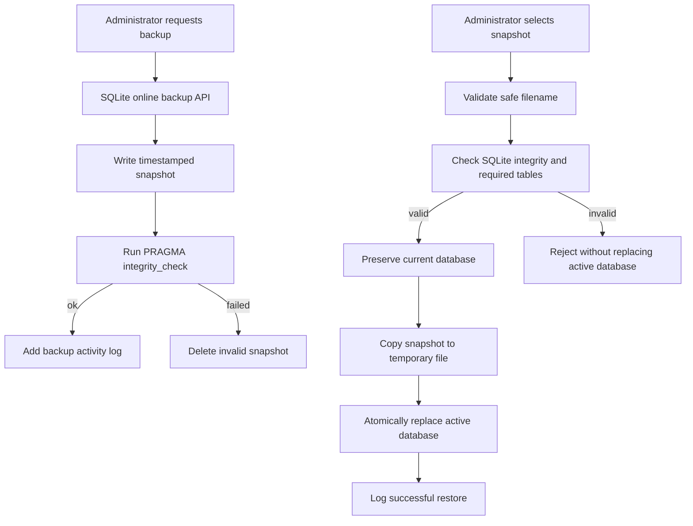

# CampusBook architecture

## Request flow

1. The React client sends JSON requests over HTTP to the FastAPI application server.
2. FastAPI validates input with Pydantic and applies application rules.
3. The server reads and writes the SQLite database.
4. Backup requests use SQLite's online backup API to create a consistent database snapshot.
5. Recovery validates the selected snapshot with `PRAGMA integrity_check`, preserves the current database, and then replaces it with the verified snapshot.

## Why client/server?

The browser does not connect directly to the database. It communicates with the application server using HTTP. This separation centralizes validation, database access, and backup permissions.

## Backup and recovery test scenario

1. Start the API and create a student record.
2. Create a backup using the Backup & Recovery page.
3. Delete the student record.
4. Confirm the record no longer appears.
5. Restore the earlier backup.
6. Confirm the student record reappears.
7. Inspect the activity log and the server's backup directory.

## Important implementation boundary

The first version uses SQLite because it is simple to run and demonstrate locally. SQLite is a server-side database file; the React browser client never reads it directly. For a multi-user production deployment, authentication, role-based authorization, CSRF/CORS policy, managed database storage, backup retention, and off-site copies would be required.

## Main data entities

- **Department:** unique department name and code.
- **Student:** unique matriculation number, name, email, department label, level, status, and creation timestamp.
- **Result:** student reference, course code/title, score from 0 to 100, and semester.
- **Activity log:** action, details, and UTC timestamp.

## REST endpoint summary

| Method | Endpoint | Purpose |
| --- | --- | --- |
| GET | `/api/health` | Check API availability |
| GET | `/api/dashboard` | Dashboard counts and summaries |
| GET / POST | `/api/students` | List/search and create students |
| PUT / DELETE | `/api/students/{id}` | Update and delete a student |
| GET / POST | `/api/departments` | List and create departments |
| GET / POST | `/api/results` | List and record course results |
| DELETE | `/api/results/{id}` | Delete a course result |
| GET / POST | `/api/backups` | List and create snapshots |
| POST | `/api/backups/{filename}/restore` | Validate and restore a snapshot |
| GET | `/api/activity` | Read recent activity records |

## Backup/recovery sequence

The application uses UTC timestamps for recorded events. The browser formats timestamps for display in the viewer's local timezone.
